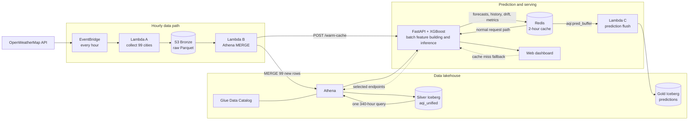

# AirPulse Architecture

AirPulse is an hourly air-quality lakehouse and next-hour AQI forecasting system. It collects pollutant readings for 99 cities, keeps the source data in Amazon S3, maintains queryable Apache Iceberg tables through Athena, and serves an XGBoost forecast dashboard through FastAPI. Redis holds precomputed forecasts and monitoring views so the normal dashboard request path is fast and does not wait for Athena.

## System diagram



## How data flows

1. **Collect:** EventBridge invokes `aqi-hourly-ingest` every hour. Lambda A requests current AQI and pollutant values from OpenWeatherMap for 99 cities, writes one partitioned Parquet file to the hourly S3 Bronze area, and asynchronously invokes Lambda B.
2. **Merge:** Lambda B runs an Athena `MERGE INTO` scoped to that new file. The operation deduplicates by city and timestamp and updates the Silver `aqi_db.aqi_unified` Iceberg table without scanning the entire raw history.
3. **Predict and precompute:** After the merge, Lambda B calls `POST /warm-cache`. FastAPI makes one Athena query for the latest 340 hours across all cities, creates the 19 model features, and runs the XGBoost next-hour classifier. The same batch computes forecast history, feature drift, class-distribution drift, model metrics, and accuracy trends.
4. **Cache and serve:** FastAPI writes the batch to Redis in one pipeline operation. Forecast, chart, drift, and metrics keys have a two-hour TTL. The browser dashboard calls FastAPI through nginx and normally receives Redis-backed responses. Selected endpoints can query Athena on a cache miss, but this is a recovery path rather than the intended steady-state request path.
5. **Persist predictions:** Each cache warm also appends one forecast per city to `aqi:pred_buffer`. At five minutes past the hour, Lambda C drains this list, writes a Parquet batch to S3, and inserts it into the Gold `aqi_db.predictions` Iceberg table. Joining Gold predictions to later Silver observations provides the actual-versus-predicted history used for monitoring.

Historical data follows the same lakehouse shape: the one-time backfill reads the bulk Bronze files and seeds the unified Silver table. S3 holds the rows; Glue holds table metadata; Athena is the query and mutation engine.

## Design decisions

### Precompute forecasts in Redis

The dashboard is interactive, while Athena is a serverless analytical engine with query startup latency and a cost proportional to scanned data. Running one scheduled batch after each hourly merge is both more predictable and cheaper than issuing an Athena query for every user request. Redis makes the common path a key lookup, lets every viewer share the same hourly computation, and keeps the displayed forecast consistent for a given source-data snapshot. A two-hour TTL covers one missed warm cycle without allowing forecasts to remain indefinitely stale.

The application retains Athena fallbacks for cache misses. Operationally, Redis plus `/warm-cache` should be treated as required for the low-latency production path; `/cache/status` and the warm-cache metrics expose failures.

### Use Iceberg rather than plain Parquet tables

The Bronze layer is append-only Parquet, but the curated layers need table behavior. Iceberg provides atomic snapshots, schema and partition metadata, and `MERGE INTO` support over files in S3. That lets the hourly job upsert and deduplicate city/timestamp rows safely, while hidden month partitioning keeps time-range queries efficient. It also separates durable storage in S3 from the Glue catalog and Athena compute layer.

### Keep evaluation time-ordered

AQI forecasting is temporal: a model is trained with observations through time T and predicts T+1. Model-selection train, validation, and test ranges therefore follow chronological order—earlier observations train the model and later observations evaluate it. A random row split could place near-identical neighboring hours, or lag-derived information from a later period, on both sides of the boundary and produce an unrealistically optimistic score. A time-ordered holdout better simulates deployment against unseen future conditions and seasonal change.

After hyperparameters are selected, the production `ml/train.py` job fits the deployable model on all engineered rows in the rolling 365-day window. The validation scores stored in `ml/best-config.yaml` are reference experiment results, not a new holdout calculated by each scheduled retrain.

## Operations

### Retraining and deployment

`.github/workflows/daily_retrain.yml` runs at 05:00 UTC daily and can also be started manually. It first runs lint and the inference/training tests, trains on the latest rolling 365 days from the Silver table, smoke-tests the five-class output, uploads the three model artifacts to S3, and copies them to EC2 through AWS Systems Manager. `POST /reload-model` hot-loads the new model, clears `aqi:*` cache keys, recomputes feature importance, and starts a background cache warm.

### Drift monitoring

AirPulse calculates both input and outcome drift during cache warming:

- Per-city and global feature z-scores compare today with yesterday or the latest seven days with the prior seven days.
- AQI-class and prediction distributions reveal changes in the target mix and model output.
- The accuracy trend compares predictions with observed AQI. A week-over-week global accuracy drop greater than 0.10 raises `concept_drift_flag`.
- Feature-importance snapshots are retained in Redis for up to 30 retrains.
- OpenTelemetry sends application metrics, traces, and logs to Grafana Cloud when its environment variables are configured.

### Tests

The suite contains **52 hermetic tests**: 16 inference tests, 14 training/feature-engineering tests, and 22 FastAPI tests. Athena is mocked and a small XGBoost artifact is generated when production artifacts are absent, so AWS credentials are not needed. CI runs Ruff and all 52 tests on pushes and pull requests; the retraining workflow runs the inference and training subsets as its safety gate.

## How to run it

Prerequisites are Python 3.12, [`uv`](https://docs.astral.sh/uv/), and—when using real data—AWS credentials that can query the AirPulse Athena tables. Redis is optional for basic development but required to reproduce the production request path.

```bash
git clone https://github.com/aneeshreddy2304/AirPulse.git
cd AirPulse
cp .env.example .env
uv sync --group dev
```

Add the required credentials and `REDIS_URL` to `.env`. Generate local model artifacts from the latest 365 days, then start the API and dashboard:

```bash
uv run python ml/train.py --lookback-days 365
uv run uvicorn app.main:app --reload --port 8000
```

Open <http://127.0.0.1:8000>. To run the API in Docker instead, use `docker compose up --build`; the current Compose file binds it to `127.0.0.1:8000`.

Run the same checks as CI:

```bash
uv run ruff check app/ ml/ tests/
uv run pytest tests/ -v --tb=short
```

The cloud pipeline is provisioned separately. With the AWS CLI and `.env` configured, deploy the hourly collector and lakehouse resources with:

```bash
bash data-pipeline/deploy_lambda.sh
bash lakehouse/deploy_lakehouse.sh
uv run python lakehouse/backfill.py  # one-time historical load
```

See `data-pipeline/`, `lakehouse/`, `ml/`, `app/`, and `deploy/` for component-level deployment and operating notes.
