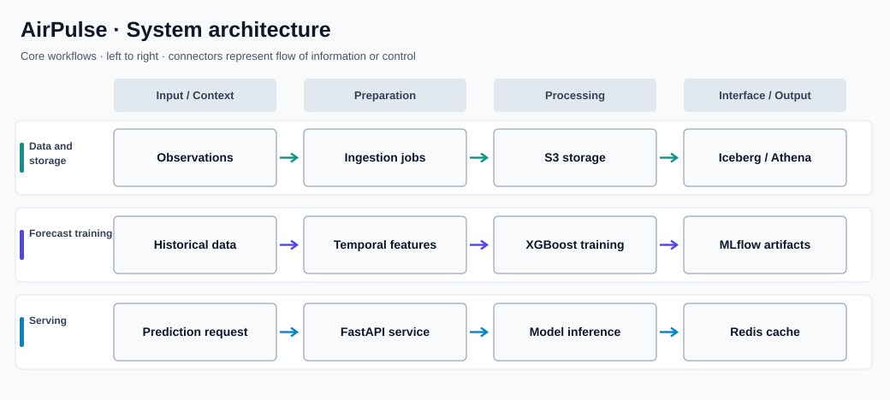

# AirPulse

**Air-quality data engineering, forecasting, and model serving**

## Overview

AirPulse connects environmental-data collection, cloud storage, feature engineering, machine learning, and an HTTP prediction service. The repository separates its data pipeline, lakehouse, model training, API, and deployment concerns instead of treating forecasting as a notebook-only exercise.

### Why this project matters

An air-quality forecast is useful only when data can be ingested consistently and predictions can be served through a dependable interface. AirPulse models the full path from environmental observations to an operational inference endpoint.

## Key capabilities

- Collects and prepares environmental and air-quality observations for downstream analysis.
- Uses an AWS-based storage and query path involving S3, Apache Iceberg, Glue, and Athena.
- Builds historical and temporal features for XGBoost-based forecasting.
- Tracks model workflows and artifacts with MLflow.
- Exposes prediction functionality through FastAPI with Redis-backed caching.
- Organizes pipeline, API, model, deployment, and validation modules into separate directories.

## System architecture



The diagram organizes the major flows into aligned lanes to make their responsibilities and handoffs clear. It is a high-level view; individual modules may also communicate across lanes.

### How it works

Environmental observations enter the data pipeline and are prepared for the lakehouse and feature-engineering workflows. The machine-learning layer trains and manages forecasting artifacts, while the application layer loads the appropriate artifacts to answer prediction requests.

The API and caching components form the serving path; cloud credentials and external services are provided through local configuration rather than embedded in the README.

## Technology stack

| Technology | Purpose |
| --- | --- |
| **Python / pandas** | Data ingestion and transformation |
| **AWS S3 / Glue / Athena** | Cloud storage, catalog, and query |
| **Apache Iceberg** | Lakehouse table format |
| **XGBoost / scikit-learn** | Machine-learning workflows |
| **MLflow** | Model experiment and artifact tracking |
| **FastAPI / Redis** | Inference API and cache |
| **Docker / uv** | Reproducible environments and services |

## Repository structure

```text
data-pipeline/  Environmental data ingestion and preparation
lakehouse/      Lakehouse storage and query modules
ml/             Forecasting and model workflows
app/            Prediction API and application components
deploy/         Deployment configuration
tests/          Validation tests
pyproject.toml  Python dependencies and tooling
```

## Getting started

```bash
cp .env.example .env
uv sync --frozen --group dev
# Configure the required external services and model artifacts.
# Refer to app/ and deploy/ for the service entry points.
```

## Notes and prerequisites

The complete workflow depends on configured data sources, authorized AWS access, and compatible saved model artifacts. The project includes separate service and infrastructure components; it is not a standalone script requiring no configuration.
