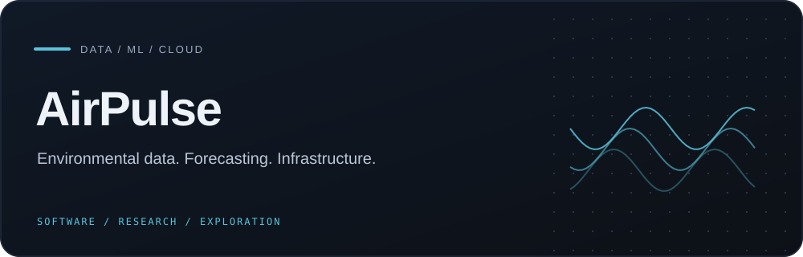
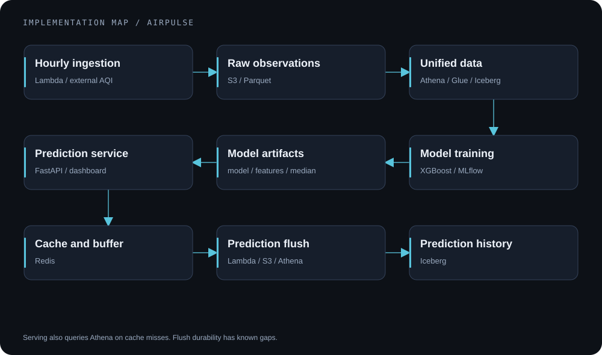
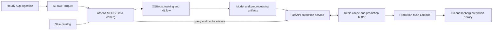

# AirPulse

     

**An air-quality forecasting project connecting environmental data, a lakehouse, model training, and an observable prediction service.**

[Architecture](#architecture) · [Run locally](#run-locally) · [Verification](#verification) · [Technical documentation](#technical-documentation)

## The engineering problem

A forecast needs more than a trained model: observations must arrive in a consistent schema, historical data must remain queryable, and training and serving must agree on features. AirPulse explores that complete path using hourly environmental observations and next-hour AQI classification.

**Status:** implemented ML/data/cloud project under development. Running the deployed architecture requires separately provisioned AWS resources and model artifacts. This repository is not a turnkey public prediction service.

## What is implemented

- **Ingestion and storage:** Python/Lambda ingestion, S3 Parquet files, and Athena/Glue-backed Iceberg tables.
- **Model training:** XGBoost classification, 19 engineered features, class/transition weighting, and MLflow tracking.
- **Inference:** a portable model/features/median artifact contract used by FastAPI.
- **Serving and analysis:** Redis-backed responses, prediction history, feature importance, drift calculations, and an HTML dashboard.
- **Operations:** Docker/EC2 deployment configuration, GitHub Actions workflows, and optional OpenTelemetry/Prometheus instrumentation.

## Architecture



*Implementation illustration, not a deployment screenshot or evidence that a live service is available.*



## Engineering decisions

| Decision | Purpose | Tradeoff |
|---|---|---|
| Iceberg tables over S3 data | Support queryable history and merge operations | Requires catalog configuration and careful replay semantics |
| Explicit model artifact files | Keep inference independent of an MLflow server | Schema/version compatibility must be managed together |
| Per-city lag features | Avoid borrowing another city's observations | Missing/duplicate hours still require validation |
| Redis in front of Athena | Reuse query/inference results | Cache freshness and buffer durability need explicit handling |

The model uses preceding observations to predict an AQI class at the next row. Treating those rows as consecutive hours requires continuous, deduplicated input data.

## Run locally

Use Python **3.12+** and [uv](https://docs.astral.sh/uv/). From the repository root:

```bash
uv sync --frozen --group dev
cp .env.example .env
```

For a configured service, supply your own authorized AWS resources/settings and these local files:

```text
ml/model-registry/model.ubj
ml/model-registry/features.json
ml/model-registry/median.json
```

Those production model artifacts are intentionally not tracked. Obtain a compatible artifact set or train in your own configured environment; synthetic test artifacts are not a production model.

```bash
# Only after configuration and artifacts are available:
uv run uvicorn app.main:app --host 127.0.0.1 --port 8000
```

The API serves the dashboard at the root route. Review [application configuration](app/README.md) and [deployment notes](deploy/README.md) before connecting cloud services. Training and deployment scripts perform external operations and are not needed to read the project.

## Verification

At audited source commit `31db47e`, **52 existing tests passed** in an isolated audit environment: 16 inference, 14 training-logic, and 22 API tests. API checks used mocked Athena and synthetic model artifacts; the background cache warmer was disabled. Ruff also passed on `app/`, `ml/`, and `tests/`.

These results establish tested behavior within that scope, not real-world model quality, cloud availability, or full endpoint coverage. The audit used core versions aligned with the lockfile, not a complete frozen environment.

```bash
# Focused inference/data-transformation checks; no live training:
uv run pytest tests/test_inference.py tests/test_training_logic.py -q
uv run ruff check app/ ml/ tests/
```

See [test scope and lifecycle behavior](tests/README.md) before running API tests.

## Current boundaries

- Daily model promotion checks prediction shape/probabilities; it does not establish a fresh temporal-holdout improvement. Saved search metrics are historical reference values.
- Prediction flushing currently reads and deletes the Redis buffer before durable persistence; concurrent writes or downstream failures can lose records.
- The checked-in nginx configuration does not authenticate `/warm-cache` or `/reload-model`. Restrict these control endpoints before exposing a deployment publicly.
- AWS identifiers in scripts are project-specific examples of the existing configuration. Use your own resources; no deployment or benchmark is promised by this README.

## Technical documentation

| Area | Source and explanation |
|---|---|
| Prediction service | [app/README.md](app/README.md) |
| Training and artifact contract | [ml/README.md](ml/README.md) |
| Lakehouse | [lakehouse/README.md](lakehouse/README.md) |
| Deployment | [deploy/README.md](deploy/README.md) |
| Tests | [tests/README.md](tests/README.md) |
| Ingestion configuration | [data-pipeline/config.yaml](data-pipeline/config.yaml) |
