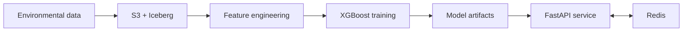

     

<strong>An end-to-end air-quality forecasting platform spanning ingestion, lakehouse storage, model training, and a FastAPI prediction service.</strong>

## Overview

An end-to-end air-quality forecasting platform spanning ingestion, lakehouse storage, model training, and a FastAPI prediction service.

### Why it matters

AirPulse treats forecasting as a data-system problem, keeping collection, historical storage, training artifacts, serving, and observability connected.

## Key features

- Hourly environmental-data ingestion
- S3, Athena, Glue, and Iceberg lakehouse path
- XGBoost training with MLflow tracking
- FastAPI inference with Redis-backed responses

## Architecture

## Technology stack

**python** · **fastapi** · **xgboost** · **aws** · **iceberg** · **redis**

## Getting started

Use Python 3.12+ and `uv sync --frozen --group dev`, copy `.env.example`, and provide authorized cloud configuration plus compatible model artifacts. Start the API only after those prerequisites are in place.
